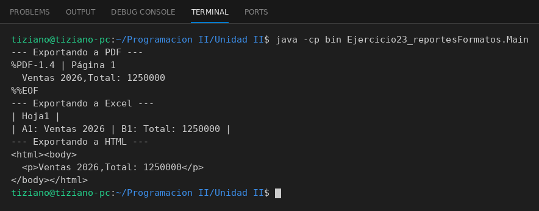

# GeneradorReporte

Programación II - Unidad 2 - Ejercicio 23

## Consigna
Un sistema de gestión exporta datos en distintos formatos mediante una interfaz común.

## Lógica
- Interfaz `GeneradorReporte` con `exportar(String contenido)`.
- `ReportePDF`, `ReporteExcel` y `ReporteHTML` simulan cada formato por consola.
- `SistemaGestion` recibe cualquier `GeneradorReporte` y procesa los datos sin conocer el formato.
- `Main`: exporta el mismo conjunto de datos a los tres formatos.

## Ejecución

